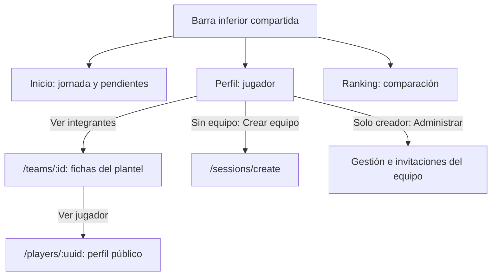

# Inicio y Perfil: información sin duplicar

16/11/2026. Continuación de la revisión visual del usuario, que señaló la repetición de identidad, equipo y OVR entre ambas pantallas.

Capturas aportadas para el contraste: [Inicio anterior](inicio-antes.png) y [Perfil anterior](perfil-antes.png).

- Rama: `codex/profile-sections-navigation-20261116`.
- Worktree: `C:/Users/Crist/Proyectos/Atleta/.worktrees/h0-h3-profile`.
- Base de esta iteración: `a53ff9dde4aa9ff605a92fb532aa9c13286ede92`.
- Implementación de separación: `2f30be5`; plantel: `1482f09`; acceso único y commit final probado: `fd33395f94fa879b99854d3399cd2c164454205e`.
- Los checkouts originales de raíz y atleta-app conservan sus cambios. Sin push, merge ni despliegue.

## Responsabilidad de cada pantalla

| Pantalla | Información propia |
|---|---|
| Inicio | Invitaciones pendientes, partido actual/próximo/último, racha de participación, progreso XP y actividad reciente |
| Perfil | Identidad, posiciones, OVR y explicación, estadísticas personales, trofeos y acceso al equipo |
| Plantel | Identidad del equipo, integrantes, posiciones, roles, OVR y desglose por posición |
| Ranking | Comparación y clasificación de jugadores |

Inicio deja de repetir identidad, OVR y equipo. También se retira su tarjeta XP duplicada: la barra de progreso permanece. Perfil deja de repetir el equipo en la cabecera; aparece solo en «Mi equipo». Las peticiones directas de Inicio a overall y equipos se eliminan; el historial sigue usando su contrato existente.

«Ver integrantes» es el único acceso desde Perfil al plantel completo. La creación de equipo se traslada al Perfil sin equipo. El creador conserva Administrar, invitaciones y eliminación; los demás no reciben esos controles. El error de equipos no se representa como ausencia: muestra mensaje y reintento, sin ofrecer crear otro equipo por un fallo HTTP.

Se mantienen rutas canónicas, guards y redirección `/ranking` → `/leaderboard`. El perfil público de otro jugador no es una segunda ruta al perfil propio. Graphify se ejecutó sobre nueve archivos concretos: 201 nodos, 358 relaciones, 0 tokens de API. [Grafo](navigation/graph.json) e [informe AST](navigation/GRAPH_REPORT.md); el mapa visual anterior se contrastó con los templates y E2E, no se infirió solo del AST.

## Verificación

- `npm run build` y `npm run lint`: correctos. Build conserva únicamente el aviso preexistente Stencil `empty-glob`.
- Angular: **263 correctas**. Se sustituyeron las pruebas de datos retirados de Inicio por comprobaciones de responsabilidad y ausencia de llamadas innecesarias; se añadieron comprobaciones de traslado, permisos y recuperación.
- Playwright: **20 correctas** en `13-profile-h3`, `14-profile-navigation`, `15-home-profile-responsibilities`, `16-team-squad`, a 390/1440 × 844 px; **9 regresiones existentes correctas** seleccionadas de `08-match-flow-captures` (incluye Inicio a 320, 390 y 1366 px).
- Carga, vacío, 500/reintento, OVR con teclado, valores ausentes frente a cero, gráfico y alternativa textual, Ajustes, creación/recuperación de equipo y navegación al plantel comprobados.
- Capturas tomadas después de la transición Ionic, sin superponer la página saliente. Metadatos JSON registran commit, fuente limpia, ruta, entorno y viewport.

[Inicio móvil](after/inicio-data-390.png) · [Inicio escritorio](after/inicio-data-1440.png) · [Perfil móvil](after/perfil-data-390.png) · [Perfil escritorio](after/perfil-data-1440.png) · [Perfil sin equipo](after/perfil-empty-390.png).

`after/` contiene las vistas comparables; `profile-states/` registra la regresión H3 en esta revisión. La evidencia histórica H0/H3 y de la opción 3 anterior permanece intacta. [Plantel](../team-squad-2026-11-16/verificacion.md) · [QA visual](../../design-qa.md).

## Pendientes

API de beta pendiente de cuenta de prueba. No se verificaron teléfono físico ni lector de pantalla. No se modificó backend ni se publicaron cambios. Las sesiones abiertas en Chrome son simuladas, sin credenciales reales.
