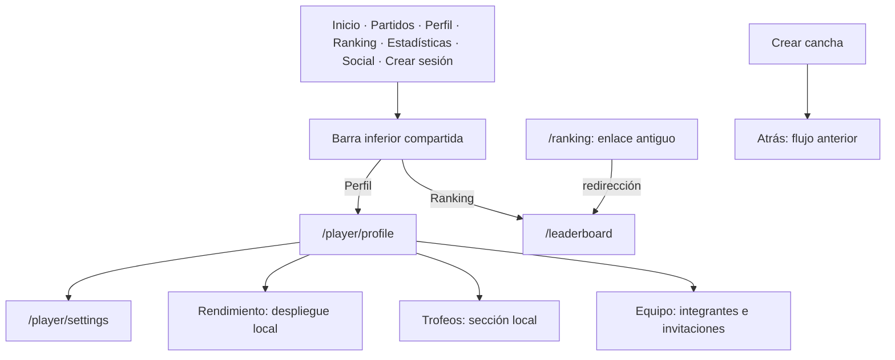

# Mapa de accesos: Perfil y Ranking

Base: `6f9e0053345445b0add2d259528edd7dd97f663b`. Implementación: `0b47f3ac0aac6a583317cd19e2cbf51b89237d08`. Rama: `codex/profile-sections-navigation-20261116`.

Graphify extrajo el AST de siete archivos concretos de rutas, navegación y consumidores: 179 nodos, 302 relaciones, 0 tokens API. [Grafo estructural](graph.json), [informe automático](GRAPH_REPORT.md). Alcance parcial, no representa todo el repositorio. Los botones y destinos siguientes se contrastaron con sus templates y E2E: el AST por sí solo no detecta duplicados visuales.

| Lugar | Antes | Ahora | Fuente bajo src/app |
|---|---|---|---|
| Estadísticas, Social, Crear sesión | Perfil en PageNav y barra inferior | Perfil solo en barra; Atrás se conserva | Templates de esas páginas, `shared/ui/page-nav` |
| Estadísticas | «Ver ranking completo» y Ranking en barra | Ranking solo en barra | `features/social/pages/stats` |
| Crear cancha | Atrás y Perfil, sin barra inferior | Solo Atrás, hacia el flujo de Partidos | `features/matches/pages/venue-create` |
| Perfil | «Ver partidos», «Próximos» y Partidos en barra | Partidos solo en barra; el hub conserva próximos e historial | `features/user/pages/player-profile` |
| Router | Una página Perfil y una página Ranking, alias `/ranking` | Sin nuevas rutas ni páginas duplicadas | `app.routes.ts` |

Canónicas: `/player/profile` y `/leaderboard`. `/ranking` se conserva como redirección de compatibilidad, sin renderizar otra página. `/players/:uuid` es un perfil público ajeno, no el perfil propio. Las redirecciones de onboarding y la recuperación de Atrás a Perfil se conservan: son continuidad/recuperación del flujo, no accesos de menú. Guards de autenticación y onboarding intactos.

La barra se define en `shared/navigation/main-bottom-nav.ts` y los destinos en `core/services/navigation.service.ts`; no se crearon definiciones alternativas. `e2e/14-profile-navigation.spec.ts` verifica unicidad en siete pantallas, clics a destinos canónicos, alias y salida de Crear cancha a 390/1440 px. Se espera al final de la transición Ionic antes de contar el nuevo menú.
